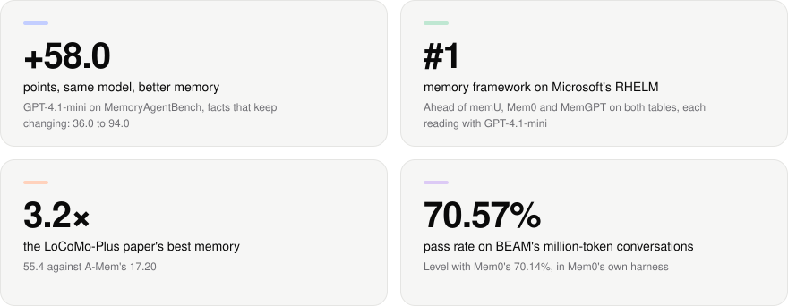
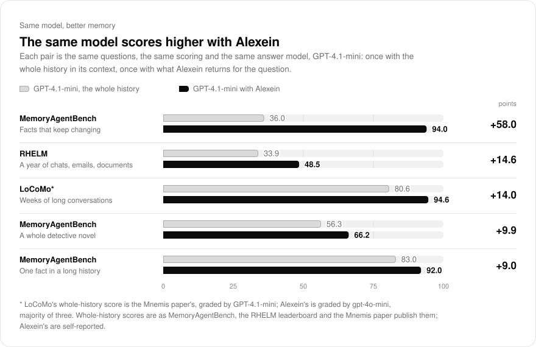
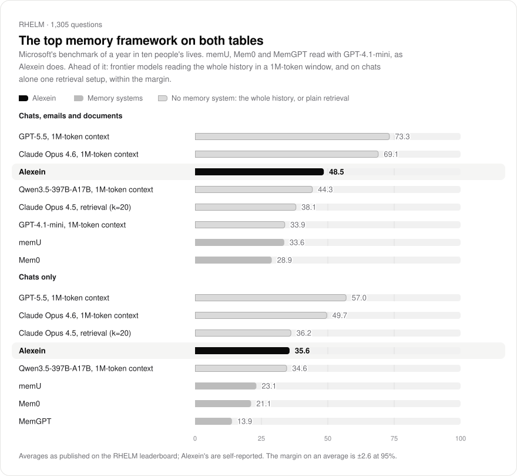
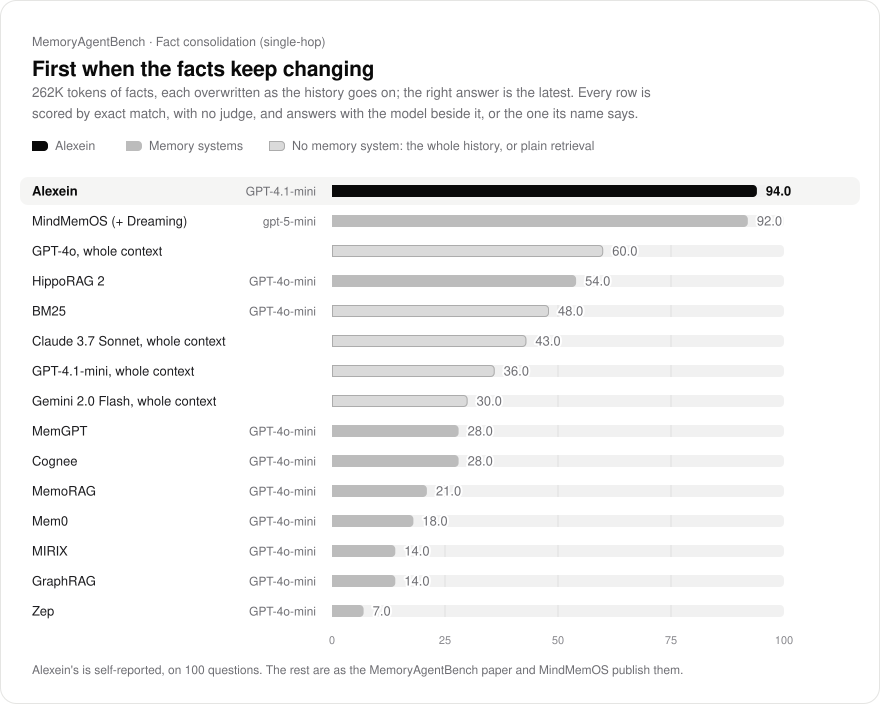
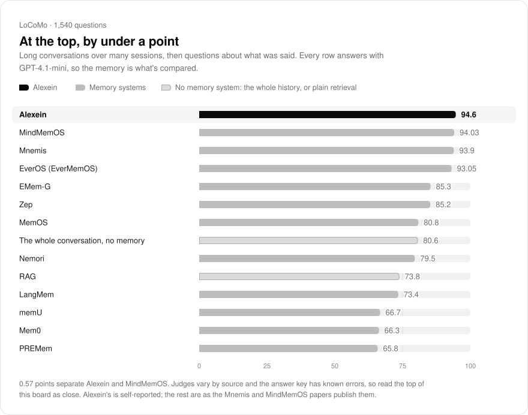
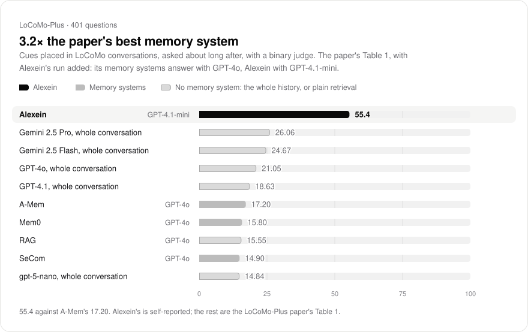
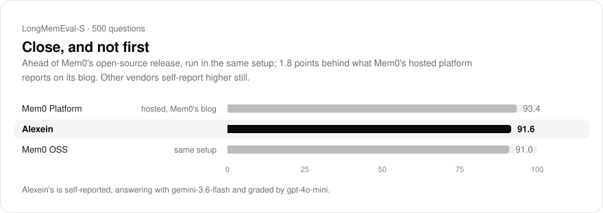
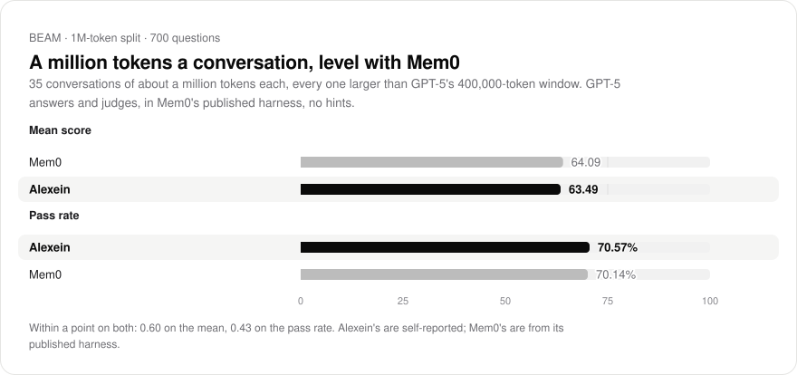
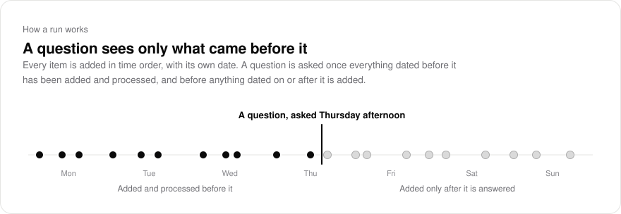

<p align="center">
  <picture>
    <source media="(prefers-color-scheme: dark)" srcset="assets/alexein-dark.svg">
    
  </picture>
</p>

<h1 align="center">Alexein benchmarks</h1>

<p align="center">
  The numbers on <a href="https://alexein.ai/benchmarks">alexein.ai/benchmarks</a>, and the code to run each one yourself<br>
  against Alexein's public API, with one command and your own keys.
</p>

<p align="center">
  <a href="LICENSE"></a>
  
  <a href="https://docs.astral.sh/uv/"></a>
  <a href="https://alexein.ai/benchmarks"></a>
</p>

<p align="center">
  <a href="#at-a-glance">At a glance</a> ·
  <a href="#results">Results</a> ·
  <a href="#benchmark-by-benchmark">Benchmark by benchmark</a> ·
  <a href="#run-one">Run one</a> ·
  <a href="#what-a-run-writes">What a run writes</a> ·
  <a href="#how-a-run-works">How a run works</a>
</p>

<br>

## At a glance

<picture>
  <source media="(prefers-color-scheme: dark)" srcset="assets/glance-dark.svg">
  
</picture>

<br><br>

The clearest test of a memory is to hold everything else still. Same questions, same scoring,
same answer model. The only thing that changes is whether the model reads the whole history or
reads Alexein:

<picture>
  <source media="(prefers-color-scheme: dark)" srcset="assets/same-model-dark.svg">
  
</picture>

## Results

Every number below is written exactly as the website shows it, and every row runs with one
command, written out under its benchmark below (or run `alexein-bench list`). Alexein's results
are self-reported; the other systems' results in the charts are as their own sources publish
them, each linked under its chart.

<!-- results:start -->
| Benchmark | Alexein | Questions | Answers / grades | Run it |
|---|---:|---:|---|---|
| [RHELM](https://github.com/microsoft/RHELM)<br>Chats, emails and documents | **48.5** | 1,305 | gpt-4.1-mini / gpt-4.1-mini | [Command](#rhelm) |
| [RHELM](https://github.com/microsoft/RHELM)<br>Chats only | **35.6** | 1,305 | gpt-4.1-mini / gpt-4.1-mini | [Command](#rhelm) |
| [MemoryAgentBench](https://arxiv.org/abs/2507.05257)<br>Fact consolidation (single-hop) | **94.0** | 100 | gpt-4.1-mini / no model (exact match) | [Command](#memoryagentbench) |
| [MemoryAgentBench](https://arxiv.org/abs/2507.05257)<br>RULER-QA1, accurate retrieval | **92.0** | 100 | gpt-4.1-mini / no model (exact match) | [Command](#memoryagentbench) |
| [MemoryAgentBench](https://arxiv.org/abs/2507.05257)<br>DetectiveQA, all 10 books | **66.2** | 71 | gpt-4.1-mini / no model (exact match) | [Command](#memoryagentbench) |
| [LoCoMo](https://github.com/snap-research/locomo)<br>All questions, categories 1-4 | **94.6** | 1,540 | gpt-4.1-mini / gpt-4o-mini, majority of three | [Command](#locomo) |
| [LoCoMo-Plus](https://arxiv.org/abs/2602.10715)<br>All questions | **55.4** | 401 | gpt-4.1-mini / the paper's judge | [Command](#locomo-plus) |
| [LongMemEval-S](https://github.com/xiaowu0162/LongMemEval)<br>All questions | **91.6** | 500 | gemini-3.6-flash / gpt-4o-mini | [Command](#longmemeval-s) |
| [BEAM, 1M-token split](https://arxiv.org/abs/2510.27246)<br>Mean score | **63.49** | 700 | gpt-5 / gpt-5 | [Command](#beam) |
| [BEAM, 1M-token split](https://arxiv.org/abs/2510.27246)<br>Pass rate | **70.57%** | 700 | gpt-5 / gpt-5 | [Command](#beam) |
<!-- results:end -->

Each command runs the same dataset, questions, prompts, models and scoring as the published
setup. Expect a score close to the published one, not the same digits. Some benchmarks sample
their models, as RHELM does, so every run is one draw. And Alexein keeps improving, so a run
today reads the memory of today.

## Benchmark by benchmark

Every chart draws each bar from 0 on the same 0 to 100 scale, so a small gap looks as small as it
is. Alexein is in ink, other memory systems in grey, and anything with no memory system, a model
reading the whole history or plain retrieval, as a pale bar.

### RHELM

<picture>
  <source media="(prefers-color-scheme: dark)" srcset="assets/rhelm-dark.svg">
  
</picture>

Sources: [RHELM leaderboard](https://github.com/microsoft/RHELM) ·
[RHELM, arXiv 2605.31086](https://arxiv.org/abs/2605.31086)

```sh
alexein-bench run rhelm --variant with      # chats, emails and documents
alexein-bench run rhelm --variant without   # chats only
```

### MemoryAgentBench

<picture>
  <source media="(prefers-color-scheme: dark)" srcset="assets/memoryagentbench-dark.svg">
  
</picture>

Sources: [MemoryAgentBench, arXiv 2507.05257](https://arxiv.org/abs/2507.05257) ·
[MindMemOS, arXiv 2608.12428](https://arxiv.org/abs/2608.12428). The same model reading the whole
history is in the chart [at the top](#at-a-glance), for all three sets.

```sh
alexein-bench run mab --variant fc          # fact consolidation, single-hop
alexein-bench run mab --variant ruler       # RULER-QA1, accurate retrieval
alexein-bench run mab --variant detective   # DetectiveQA, all 10 books
```

### LoCoMo

<picture>
  <source media="(prefers-color-scheme: dark)" srcset="assets/locomo-dark.svg">
  
</picture>

Sources: [Mnemis, arXiv 2602.15313](https://arxiv.org/abs/2602.15313) ·
[MindMemOS, arXiv 2608.12428](https://arxiv.org/abs/2608.12428). LoCoMo's answer key has known
errors, listed in an [audit of it](https://github.com/dial481/locomo-audit); they affect every
top system's score.

```sh
alexein-bench run locomo --variant all
```

### LoCoMo-Plus

<picture>
  <source media="(prefers-color-scheme: dark)" srcset="assets/locomo-plus-dark.svg">
  
</picture>

Source: [LoCoMo-Plus, arXiv 2602.10715](https://arxiv.org/abs/2602.10715). This harness gives
each LoCoMo conversation one app user holding all the cues placed in it. A later paper reports a
higher score from its own runs.

```sh
alexein-bench run locomo_plus --variant all
```

### LongMemEval-S

<picture>
  <source media="(prefers-color-scheme: dark)" srcset="assets/longmemeval-dark.svg">
  
</picture>

Source: [Mem0's blog](https://mem0.ai/blog/the-token-efficient-memory-algorithm-now-has-temporal-reasoning),
for Mem0 Platform's figure. The benchmark:
[LongMemEval](https://github.com/xiaowu0162/LongMemEval). Its published setup answers with a
model other than OpenAI's, so this one needs an OpenRouter key.

```sh
alexein-bench run longmemeval --variant all
```

### BEAM

<picture>
  <source media="(prefers-color-scheme: dark)" srcset="assets/beam-dark.svg">
  
</picture>

Sources: [Mem0's published BEAM harness](https://github.com/mem0ai/memory-benchmarks) ·
[BEAM, arXiv 2510.27246](https://arxiv.org/abs/2510.27246).
[Hindsight](https://hindsight.vectorize.io/blog/2026/04/02/beam-sota) and
[Exabase](https://exabase.io/research/exabase-achieves-state-of-the-art-on-beam-benchmark) report
BEAM accuracy from their own setups; the only like-for-like comparison here is the one with Mem0.

```sh
alexein-bench run beam --variant 1m         # the mean score and the pass rate, in one run
```

## Run one

You need [uv](https://docs.astral.sh/uv/) and two keys:

- **An Alexein key that reads and writes** (`tm_...`) from
  [app.alexein.ai/console](https://app.alexein.ai/console). Give the benchmark a project of its
  own: a run creates app users there and erases them when it finishes.
- **A model key** for the models that answer and grade: OpenAI (`sk-...`) or OpenRouter
  (`sk-or-...`). Benchmarks whose published setup uses a model other than OpenAI's need an
  OpenRouter key, and tell you so before they start.

```sh
uvx --from git+https://github.com/Alexein-AI/alexein-benchmarks alexein-bench run rhelm
```

On the first run you are asked for both keys. They are kept in
`~/.config/alexein-bench/keys.env`, readable by you alone, or taken from `ALEXEIN_API_KEY` and
`OPENAI_API_KEY` / `OPENROUTER_API_KEY` if those are set. Before anything is spent, the run shows
how many app users, items and searches it will use from your Alexein plan and roughly what the
models will cost on your key, then asks you to confirm. When it finishes, it prints the published
number beside yours.

```sh
alexein-bench list                                  # every number, and the command that runs it
alexein-bench run rhelm --variant with --limit 20   # a quick check on 20 questions
alexein-bench run rhelm --resume 20261117a1b2c3     # carry on a run that stopped
alexein-bench clean                                 # erase app users a stopped run left
```

From a clone: `uv run alexein-bench ...`.

## What a run writes

Everything a run produces goes in `runs/<benchmark>/<variant>/<run>/`, and each file is written
as the run goes, so a stopped run loses nothing it had finished:

| File | What it holds |
|---|---|
| `results.jsonl` | One row per question as soon as it is scored: the question, the expected answer, the model's answer and the score. |
| `traces.jsonl` | Everything behind each row: what was searched, the search's whole answer, the context the model read, and each model call's request, reply and token use. |
| `running.txt` | The score so far every 10 questions (`--every N` to change), overall and by category, with errors and spend. The same line is printed as the run goes. |
| `summary.json` | The same, rewritten each time, so it is current even for a run that stopped. |

While it runs, a status line every 30 seconds (`--status N` to change) says how many questions
are answered, how many app users are done, running or waiting, and what each running one is doing
and for how long - adding items, processing them, or asking:

```
[18:12:40] 6m30s · 2/5 answered · units 1 done, 4 running, 0 waiting · plus-1 asking 1/1 (4s) · plus-2 processing 648/665 items (5m40s) · ... · models $0.01
```

**Stopping and resuming.** Ctrl-C lets the questions already being asked finish and be written,
then stops. `--resume <run>` carries on: questions already scored are not asked again; an app
user that was part way through keeps its memory and is given only the items it does not hold yet.
If that memory holds anything a question still to be asked must not see, it is erased and built
again from the start. App users are erased only once all their questions are answered, so
`alexein-bench clean` removes those of a run you give up on.

## How a run works

<picture>
  <source media="(prefers-color-scheme: dark)" srcset="assets/how-a-run-works-dark.svg">
  
</picture>

<br>

Each benchmark is run the way an app would use Alexein, through the public
[Python client](https://pypi.org/project/alexein/):

1. **One app user per unit**: a LoCoMo conversation, a LongMemEval question's history, a RHELM
   character. Each starts empty and is erased when it is done.
2. **History added in time order.** Each item (a message, an email, a document) is added with
   its own date. A question is asked only once everything dated before it has been added and
   processed, and nothing from on or after its date is in memory yet. A question about last
   Tuesday sees only what was said before it was asked.
3. **One search per question.** The question goes to `search` as it is written. The memories
   that come back, rendered by the client's `context()`, are what the answering model reads,
   in the benchmark's own answer prompt.
4. **The benchmark's own scoring**: its judge prompt and model, or its exact-match metric,
   copied from the benchmark's authors. Each module names the source and version of what it
   copies.

Datasets are downloaded from their authors on first use, at a pinned version, and cached in
`~/.cache/alexein-bench`. Nothing from them is stored in this repository.

## Checking this repository

```sh
make check    # lint, types, tests (offline), and the public-text check
make readme   # redraw the README's table and charts from results/
```

The README's table and charts are drawn from `results/*.json`, and the other systems' figures
from [`assets/others.json`](assets/others.json), so neither can show a number the results don't
hold. `make check` fails if either is out of date, or if a chart's title claims something its
numbers no longer support.

## Licence

The code is MIT. The datasets are their authors', under their own licences. The answer and judge
prompts each benchmark module copies are the benchmark authors', credited where they are copied.
The Alexein name and mark are Alexein's.
